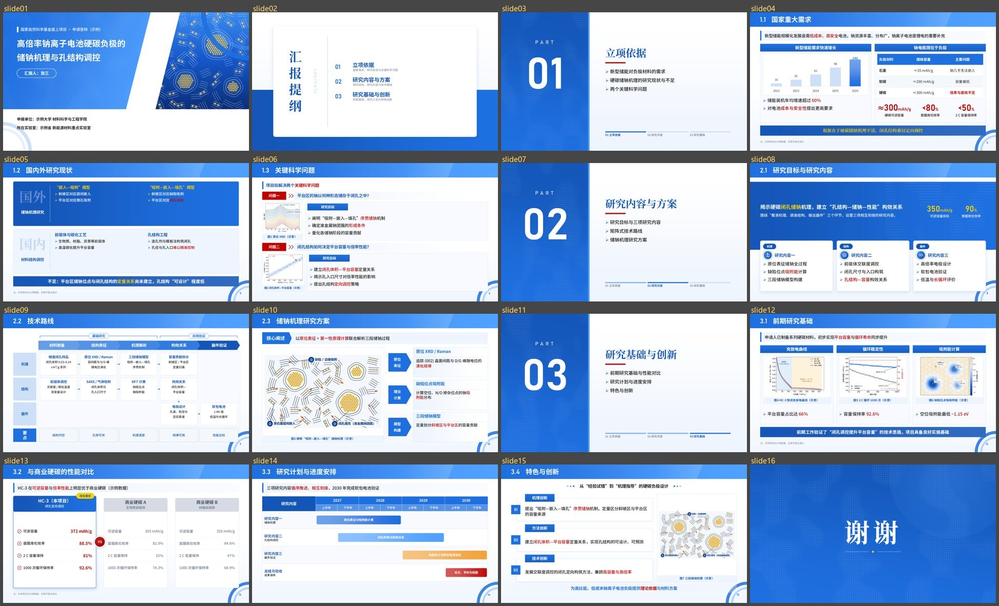
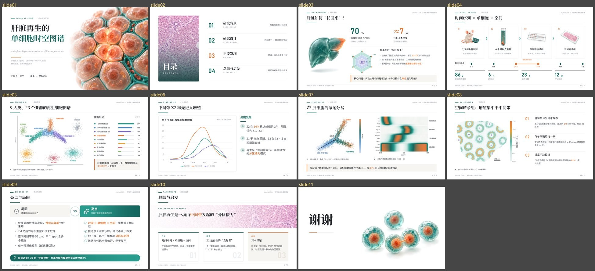
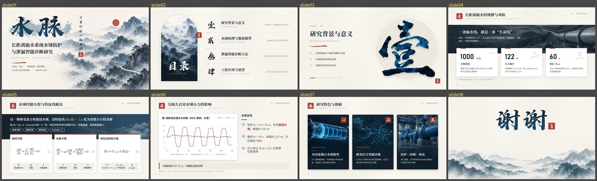

# ppt-studio · 科研汇报 PPT Skill

让 AI 用 Python 直接生成**原生可编辑**的科研汇报 PPT（论文汇报 / 组会、基金申报、科技奖申报、毕业与开题答辩）。
文字、表格、图表、图标全部是 PowerPoint 原生对象，不是截图，拿到手可以直接改。

这套 skill 由 Claude Opus 5.5 设计和编写：版式、配色、字号、间距这些“审美”已经写死在代码模板里。
换用其他模型时，只要按 `SKILL.md` 的流程**套模板、填内容**，排版也不会差到哪里去。


## 效果

三个案例都在 `examples/` 里，各是一份可直接运行的构建脚本（项目与数据均为虚构，仅用于版式演示）。

**国自然申请答辩**（16 页，几乎全部直接调用 skill 自带版式）：`examples/nsfc_sodium/`



**期刊风文献汇报**（11 页，自定义页眉页脚 + 自带版式 + 生图配图位）：`examples/journal_club/`



**水墨风科研汇报**（8 页，书法字矢量化、图片填充文字、平滑切换）：`examples/ink_showcase/`



## 它是怎么工作的

```
你的材料（论文 / 申报书 / 提纲 / 数据）
   │  SKILL.md：先定场景、页数和每页一句话结论，再按“内容结构”选版式
   ▼
一个 build.py（每页调用一个版式函数：d.panels(...)、d.problems(...)、d.schedule(...) ……）
   │  scripts/pptstudio：网格、字号自适应、配色、图标、原生图表 / 表格、公式
   ▼
.pptx + 逐页预览图 + 缩略总览（PowerPoint COM 渲染）
   │  QA：看总览、查溢出 / 碰撞 / 空白，改完再出
   ▼
交付
```

- **50 个现成版式**：问题一/问题二、技术路线（矩阵式）、拦腰总分、研究现状、对比、甘特图、创新点、风险、团队、获奖……
- **27 套主题 + 15 种答辩“皮肤”**：像素答辩、树叶答辩、亮蓝白、科技进步奖、重点研发、长江学者、重点实验室等，
  同一份内容换一行参数就换一套模板（`assets/gallery/style_*.jpg` 可以先看效果）
- **1,850 个矢量图标**（Lucide，按中文关键词检索）、原生可编辑图表与表格、真实字号的公式、论文图局部放大
- **自动 QA**：用 PowerPoint 自己的排版引擎检查文字溢出，导出逐页 PNG 和缩略总览

## 安装

1. 下载本仓库，把整个文件夹放进你所用 Agent 的 skills 目录，例如 Claude Code 的 `~/.claude/skills/ppt-studio/`
   （其他支持 skill 的 Agent 同理；不支持的，直接把 `SKILL.md` 发给 AI 也能用）。
2. 安装依赖：

   ```bash
   pip install -r requirements.txt
   ```

   渲染预览和溢出检查需要 Windows + Microsoft PowerPoint（pywin32）；没有 PowerPoint 也能生成 PPT，
   只是要自己打开检查。默认字体为思源黑体 / 思源宋体（Noto Sans SC / Noto Serif SC），未安装时自动回退到系统字体。

3. 跑一个案例试试：

   ```bash
   python examples/nsfc_sodium/build.py
   ```

## 使用建议

- 直接对 AI 说“用 ppt-studio 把这篇论文做成 15 页的组会汇报”“按国自然面上项目答辩做一份 PPT”，并把材料给它。
- **AI 会偷懒**：记得让它根据内容**从版式库里挑多种版式**，不要全篇只用一种；`SKILL.md` 里已经写了这条硬性要求，
  但提醒一句效果更好。
- **能用图就用图**：数据图用代码画（不要让生图模型画数据图）；封面、背景、概念示意这类氛围图，
  有生图模型就直接生成，没有就让 AI 先写好提示词（参考 `examples/journal_club/img/图片提示词.md`），
  你生成后放进 `img/` 重新运行即可替换占位图。
- 只适合**科研汇报风**。用到其他领域（商业路演、宣传、课件等），需要强模型把关审美，再加上你自己的判断。

## 目录结构

```
SKILL.md                 给 AI 看的完整说明（流程、版式选择、QA 清单、设计规则）
scripts/pptstudio/       Python 库（python-pptx；COM 仅用于渲染和 QA）
references/              版式参数、设计规则、场景大纲、论文转 PPT 流程、技巧与 API
assets/gallery/          全部版式与 15 种答辩皮肤的效果图
assets/icons/            Lucide 图标（ISC 许可）
examples/                三个完整案例
```

## 说明

- 案例中的项目、论文、人名、单位、数据均为虚构，仅用于展示版式。
- 设计规则来自对大量 PPT 设计案例和公开答辩版式的分析总结，仓库内**不包含**任何第三方 PPT、模板、字体或图片。

## License

MIT。图标来自 [Lucide](https://lucide.dev)（ISC License，见 `assets/icons/LUCIDE_LICENSE.txt`）。
